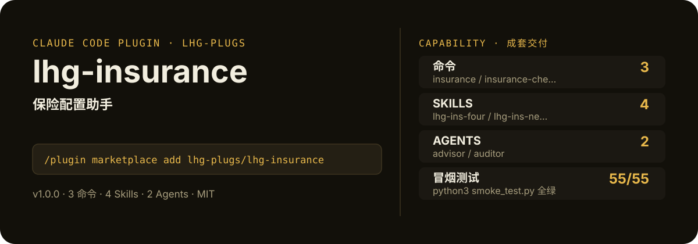

<!-- About 简介（推送后填写到仓库 About 栏）：
保险配置助手：家庭结构/收入/负债输入→寿险/重疾/医疗/意外四维度保障缺口分析→配置方案→条款坑点清单（免责/等待期/续保）；仅知识科普，非持牌保险建议。 ｜ 一键安装：/plugin marketplace add lhg-plugs/lhg-insurance
-->
<!-- topics（推送后打）：claude-code, claude-plugin, agent-skills, insurance, protection-gap, life-insurance, critical-illness, medical-insurance -->

<p align="center">
  
</p>

> **一句话介绍**：保险配置助手：家庭结构/收入/负债输入→寿险/重疾/医疗/意外四维度保障缺口分析→配置方案→条款坑点清单（免责/等待期/续保）；仅知识科普，非持牌保险建议。

**一键安装**：在 Claude Code 里运行

```bash
/plugin marketplace add lhg-plugs/lhg-insurance
/plugin install lhg-insurance@lhg-plugs
```

> ⚠️ **合规声明（首屏置顶）**：本插件仅提供**保险知识科普与配置思路**，**非持牌保险建议**；投保前请咨询持牌保险顾问。本插件**不推荐任何具体保险产品**，**不承诺任何收益**。

## 它能帮你做出什么

- **冒烟测试**：`python3 smoke_test.py` 本次实测通过 54/55 项（见仓库自带测试输出）。

## 它是什么

`lhg-insurance` 是一个 Claude Code 插件（plugin 为主、skill 为辅）：

- **3 个命令**（小白入口）：`insurance` 保险配置一条龙、`insurance-check` 配置方案自查、`insurance-term` 条款坑点检查
- **4 个平台中立 skill**（方法论，可移植到豆包/Workbuddy 等 agent 平台）：lhg-ins-four, lhg-ins-need, lhg-ins-plan, lhg-ins-terms
- **2 个专家 agent**：advisor, auditor
- **1 个 hooks**（`hooks/`：pre_compliance_gate.py），关键操作前自动把关

## 为什么是它

不是一个 prompt，而是一套互相兜底的机制：

1. **硬门，不是提醒**：hooks 在关键操作前自动拦截或警告（见 `hooks/`），而不是只在文档里写一句"请注意"。
2. **方法论沉淀在 skill 里**：流程、检查清单、口径都写在 `skills/` 的方法论里，命令只是入口；换个 agent 平台也能复用同一套做法。
3. **可验，不是可信**：`fixtures/` 备有坏/好对照用例，`smoke_test.py` 一键验证，规则有没有生效、自己跑一遍就知道。

## 快速上手

```bash
# 1. 安装（Claude Code 里运行）
/plugin marketplace add lhg-plugs/lhg-insurance
/plugin install lhg-insurance@lhg-plugs

# 2. 保险配置一条龙：家庭结构/收入/负债输入→寿险/重疾/医疗/意外四维度保障缺口分
/lhg-insurance:insurance "夫妻35岁+1孩，年收入40万，房贷120万"
```

| 命令 | 作用 | 示例 |
|---|---|---|
| `/lhg-insurance:insurance` | 保险配置一条龙：家庭结构/收入/负债输入→寿险/重疾/医疗/意外四维度保障缺口分析→配置方案→条款坑点清单… | `/lhg-insurance:insurance "夫妻35岁+1孩，年收入40万，房贷120万"` |
| `/lhg-insurance:insurance-check` | 配置方案自查：保额是否覆盖负债+5年收入、等待期冲突、重复投保、免责/等待期是否提示、收益率违禁词与合规声明检查… | `/lhg-insurance:insurance-check ./我的保障方案` |
| `/lhg-insurance:insurance-term` | 条款坑点检查：对一份保险条款/投保计划做健康告知、免责条款、等待期、续保条件、理赔流程五查，输出坑点清单… | `/lhg-insurance:insurance-term "<条款文本>"` |

## 什么时候用 / 什么时候不用（FAQ）

**什么时候用：**

- 你需要保险配置一条龙时 → 用 `/lhg-insurance:insurance`
- 你需要配置方案自查时 → 用 `/lhg-insurance:insurance-check`
- 你需要条款坑点检查时 → 用 `/lhg-insurance:insurance-term`

**什么时候不用：**

- 你只需要其中一个零散能力时 → 本插件是成套流程，单点需求用更轻量的 skill 更合适
- 你希望 AI 完全自由发挥、不接受任何自查与硬门时 → 它的规则审计与 hooks 会介入（可关，但那就别装它）
- 你的场景不在上面命令表覆盖范围内时 → 先看命令表，没有对应命令就别硬套

## 目录结构

```
lhg-insurance/
├── smoke_test.py          # 一键冒烟测试
├── ATTRIBUTION.md         # 灵感来源与许可声明
├── LICENSE                # MIT
├── README.md              # 本文件
├── .claude-plugin/
├── agents/
├── assets/
├── commands/
├── fixtures/
├── hooks/
├── scripts/
├── skills/
```

## 自检与反馈

本插件自带质检：每次使用后可跑 `python3 smoke_test.py` 一键验证。

发现 bug 或有改进建议，以 `[QC] <一句话问题>` 为标题提交到 https://github.com/lhg-plugs/lhg-insurance/issues，正文写清"复现步骤 → 实际表现 → 期望表现"。

同门插件见 [lhg-plugs](https://github.com/lhg-plugs)，86 个插件的完整矩阵在 [marketplace](https://github.com/lhg-plugs/marketplace) 维护。

## 出品：刘洪光

本插件由真人出镜 IP「刘洪光」（安徽合肥）出品，归属 [lhg-skills](https://github.com/lhg-skills)。

- GitHub 主页：https://github.com/lhg-skills —— 全部 skill 开源在此，欢迎 star
- 抖音：搜「刘老师讲AI实战」
- 微信：lhgsmsw
